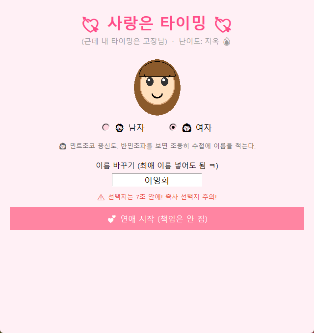
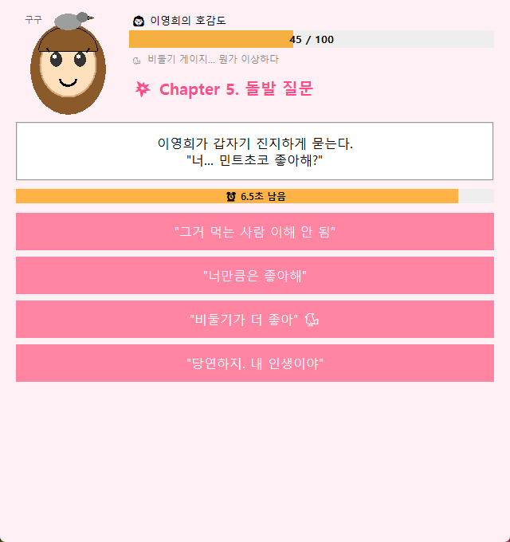
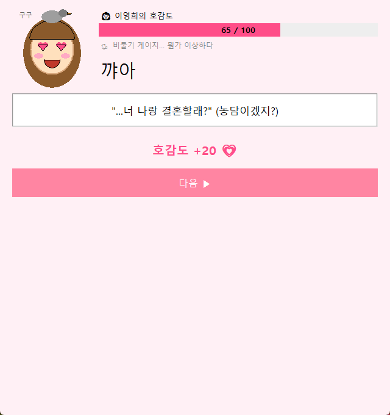
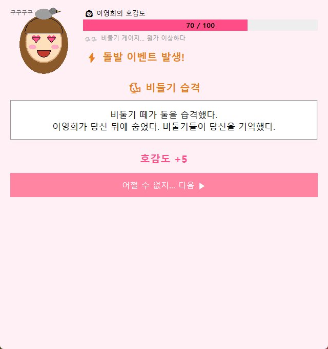
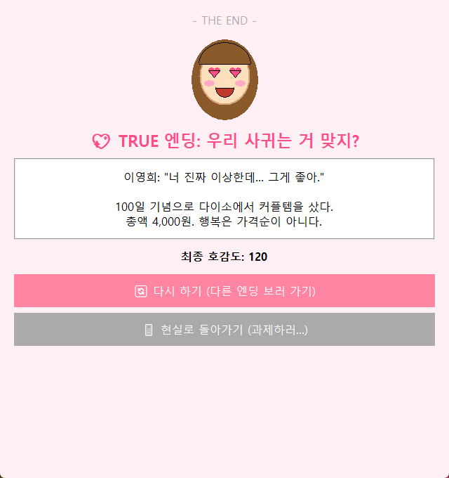
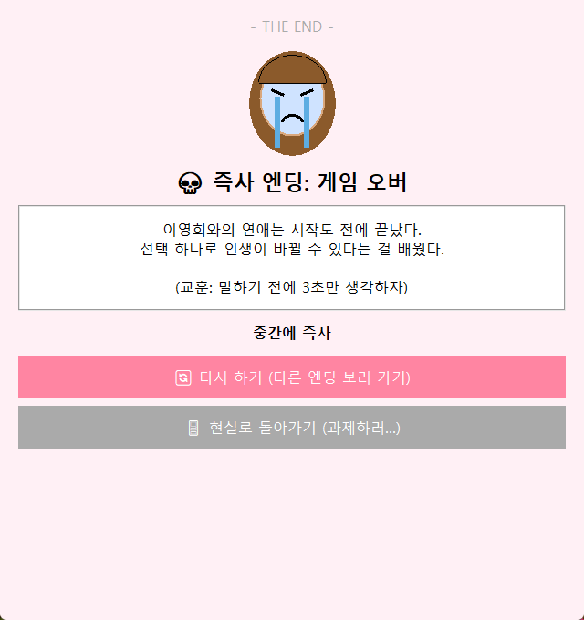

# 💘 병맛 연애 시뮬레이션

> **사랑은 타이밍, 근데 내 타이밍은 고장남**

Python tkinter로 만든 **웃긴 게 1순위**인 선택형 연애 시뮬레이션 게임입니다.


- **제출자**: AI융합소프트웨어과 1학년 박성재

---

## 📋 제출물 한눈에 보기

| 제출물 | 파일 | 설명 |
|:---:|---|---|
| 📄 **기획서** | [`docs/기획서.md`](docs/기획서.md) | 기획 의도, 재미 요소, 캐릭터, 챕터 구성, 엔딩 규칙, 기술 구성 |
| 💻 **소스 코드** | [`byungmat_love.py`](byungmat_love.py) | 게임 본체 (외부 라이브러리 없음) |
| 🧪 **테스트 코드** | [`test_byungmat.py`](test_byungmat.py) | 자동 테스트 34개 (전부 통과) |
| 🎮 **실행파일** | [`release/byungmat_love.exe`](release/byungmat_love.exe) | Windows용, 설치 없이 더블클릭으로 실행 |

---

## 👀 1분 확인 가이드

**① 실행파일로 바로 해보기 (Python 없어도 됨)**
1. [`release/byungmat_love.exe`](release/byungmat_love.exe) 클릭 → 오른쪽 위 **다운로드(⬇) 버튼**
2. 받은 파일 더블클릭
   > "Windows의 PC 보호" 창이 뜨면 **추가 정보 → 실행**을 누르세요. 개인이 만든 서명 없는 프로그램이라 나오는 경고예요.

**② 소스 코드로 실행하기** (Python 3만 있으면 됨, 설치할 라이브러리 없음)
```bash
python byungmat_love.py
```

**③ 테스트 실행하기**
```bash
python -m unittest -v test_byungmat.py
```
→ 마지막 줄에 `Ran 34 tests ... OK`가 나오면 전부 통과

---

## 🖼️ 게임 화면

| 시작 화면 | 장면 (7초 타이머) | 선택 반응 |
|:---:|:---:|:---:|
|  |  |  |
| **돌발 이벤트** | **TRUE 엔딩** | **즉사 엔딩** |
|  |  |  |

---

## 🎮 게임 소개

상대(김철수 🧔 / 이영희 👩)를 고르고, 10개의 챕터에서 **7초 안에** 말도 안 되는 선택지를 골라 호감도를 올리는 게임입니다. 난이도: **지옥** 🔥

| 재미 요소 | 내용 |
|---|---|
| 🤪 병맛 선택지 | "책 대신 학생증 건네기", "PPT 30장으로 고백", "아버님께 3대 몇 치시냐고 묻기" |
| ⏰ 7초 제한 | 시간 안에 못 고르면 '읽씹' 처리, 호감도 -15 |
| 💀 즉사 선택지 | 고르는 순간 게임 오버 (다단계 권유, 시험지 유출 등 4개) |
| ⚡ 돌발 이벤트 | 챕터 사이 35% 확률: 비, 비둘기 습격, 새똥, 단톡방 박제 등 6종 |
| 🎲 랜덤 요소 | 결과가 랜덤인 선택지, 매번 섞이는 선택지 순서 |
| 🎨 표정 변화 | 호감도에 따라 하트 눈 / 폭포 눈물, 비둘기 게이지가 있으면 머리 위에 비둘기 |
| ✍️ 이름 커스텀 | 이름을 바꿔도 조사(이/가, 은/는)가 자동으로 맞춰짐 |

### 🏁 엔딩 7종

| 엔딩 | 조건 |
|---|---|
| 💀 즉사: 게임 오버 | ??? (말하기 전에 생각하자) |
| 🐦 히든: 비둘기와의 사랑 | ??? (비둘기를 좋아하면...) |
| 💖 TRUE: 우리 사귀는 거 맞지? | 호감도 100 이상 |
| 💛 노멀: 썸의 무한루프 | 호감도 60 이상 |
| 💚 친구: 넌 좋은 사람이야 | 호감도 30 이상 |
| 💙 읽씹: 1이 사라지지 않아 | 호감도 0 이상 |
| 🚨 배드: 차단당했습니다 | 호감도 0 미만 |

---

## 🧩 코드 구조

대사·선택지 같은 **데이터**와 화면을 그리는 **로직**을 분리했습니다. 새 챕터는 `SCENES` 리스트에 딕셔너리 하나만 추가하면 됩니다.

| 구성 요소 | 역할 |
|---|---|
| `SCENES`, `EVENTS`, `CHARACTERS` | 챕터 10개 · 돌발 이벤트 6개 · 캐릭터 데이터 |
| `fill()`, `scene_text()` | 이름 받침에 맞춰 조사를 자동으로 넣음 |
| `get_ending()` | 호감도·비둘기 게이지·즉사 여부로 엔딩 결정 |
| `draw_face()`, `load_character_image()` | Canvas로 캐릭터 그리기 / `images/`의 PNG 불러오기 |
| `LoveGame` | tkinter 화면 클래스 (시작 → 장면 → 반응 → 이벤트 → 엔딩) |

**테스트 34개**가 확인하는 것: 조사 처리, 엔딩 경계값, 장면 데이터 형식, 난이도(랜덤 플레이 3000판에서 TRUE 엔딩 10% 미만), 돌발 이벤트, 캐릭터 그림, 7초 타이머, 모든 화면이 창 안에 들어가는지.

---

## 📁 폴더 구조

```
📦 병맛연애시뮬레이션
├── 📄 docs/
│   ├── 기획서.md            ← 기획서
│   └── screenshots/         ← README용 게임 화면
├── 🎮 release/
│   └── byungmat_love.exe    ← 실행파일
├── 💻 byungmat_love.py      ← 게임 소스 코드
├── 🧪 test_byungmat.py      ← 테스트 코드
├── 🖼️ images/               ← 캐릭터 PNG를 넣는 곳 (없으면 코드로 그린 그림 사용)
├── 🛠️ build_exe.bat         ← 테스트 → exe 빌드 → release/로 복사
└── README.md
```

## 🛠️ 실행파일 직접 만들기

```bash
pip install pyinstaller
build_exe.bat
```
테스트가 모두 통과해야만 `release/byungmat_love.exe`가 만들어집니다.
